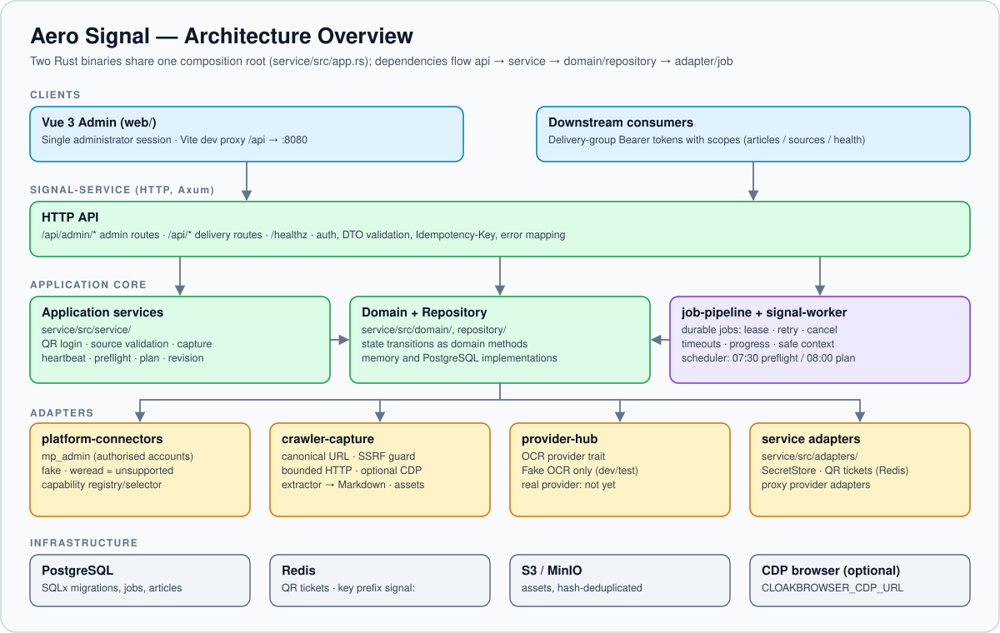
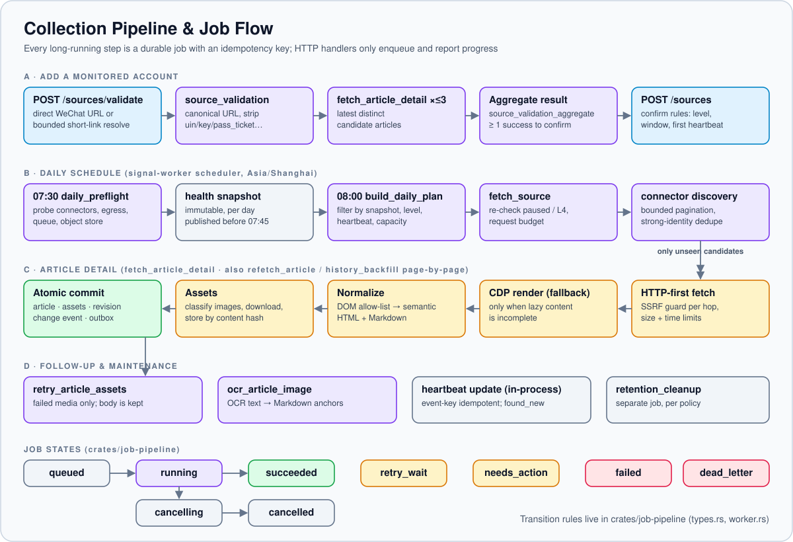
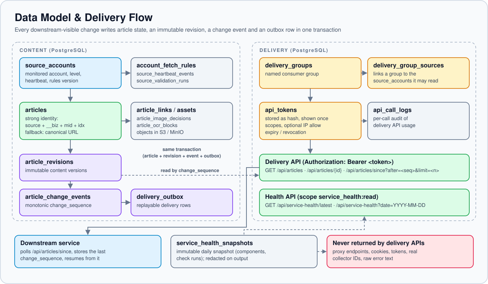
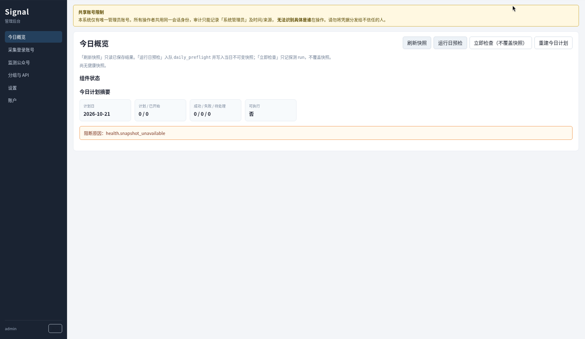

# Aero Signal

[English](README.md) | **简体中文**

<p align="center">
  
</p>

Aero Signal 是一套自托管、单服务器部署的后台系统，用来对运营者**有权处理的微信公众号文章**进行采集、清洗、版本归档和增量分发。它把监测公众号、已授权的采集账号登录、持久化后台任务、文章资产、OCR、每日健康快照和按 Token 授权的分发 API 串成一条可审计、可恢复的工作流。

> **仅限授权使用。** Aero Signal 不是反爬绕过工具，也不是公众号搜索引擎。它**不会**绕过验证码或 WAF，**不会**伪装设备或轮换指纹，也**不会**进行未授权登录。详见[合规与授权边界](#合规与授权边界)。

## 目录

- [核心能力](#核心能力)
- [架构](#架构)
- [管理后台](#管理后台)
- [技术栈](#技术栈)
- [项目结构](#项目结构)
- [快速开始](#快速开始)
- [配置](#配置)
- [API 概览](#api-概览)
- [测试](#测试)
- [合规与授权边界](#合规与授权边界)
- [项目状态与路线图](#项目状态与路线图)
- [文档](#文档)
- [参与贡献](#参与贡献)
- [许可证](#许可证)

## 核心能力

- **安全的 URL 处理**：规范化微信文章 URL，清除敏感查询参数（`uin`、`key`、`pass_ticket`、`appmsg_token` 等）；用强身份标识文章（`source + __biz + mid + idx`，取不到时退回规范化 URL）；短链解析有跳数上限，并逐跳校验。
- **已授权的采集账号**：二维码登录状态机（`waiting → scanned → confirmed / expired / failed / cancelled`）；凭据存放在 SecretStore 中，数据库里只保存引用；每个采集账号绑定固定出口。
- **发现与回填**：按能力划分的连接器（`mp_admin` 用于运营者自己管理的公众号，`fake` 用于开发）；分页有上限，初始验证最多取三篇文章，历史回填按页推进、可断点续跑。
- **HTTP 优先采集**：HTTP 抓取有 SSRF 防护、显式的重定向检查、大小上限和超时；只有在需要时，才通过可选的 Chrome DevTools Protocol（CDP）浏览器渲染懒加载内容。
- **语义化正文**：按 DOM 白名单把正文清洗成语义化 HTML 和 Markdown，保留标题、列表、引用、代码、表格、链接、图片和媒体占位。
- **资产与 OCR**：图片分类、按哈希去重的对象存储（S3/MinIO），OCR 文本以锚点回填到 Markdown。单个资源失败不会丢掉整篇正文，失败的资源会单独生成重试任务。
- **持久化任务**：任务持久保存，支持幂等键、租约、重试、超时、取消和进度上报（`crates/job-pipeline`）。
- **版本与分发**：文章 revision、变更事件和分发 outbox 在同一事务中原子提交；下游按单调递增的 `change_sequence` 增量读取。
- **日常运维**：07:30 预检、不可变的每日健康快照、08:00 生成非等间隔的每日计划，并根据心跳对监测公众号升降级。
- **管理后台**：面向唯一管理员的 Vue 3 后台，另提供按分组 Token 授权、供下游服务使用的 API。

## 架构

`signal-service` crate 构建出两个二进制，它们共用同一个组装根（`service/src/app.rs`）：

| 二进制 | 作用 |
| --- | --- |
| `signal-service` | Axum HTTP 服务：`/api/admin/*`（管理端）、`/api/*`（分发）、`/healthz` |
| `signal-worker` | 轮询并执行持久化任务；除非设置 `SIGNAL_SCHEDULER=0`，否则同时运行每日调度（07:30 预检 / 08:00 计划） |

依赖方向是 `api → service → domain / repository → adapter / job`。API handler 只负责鉴权、校验和错误映射；预计超过约两秒的操作一律作为任务入队。每个 Repository 都有内存版和 PostgreSQL 版两种实现，行为保持一致。

### 采集流水线与任务流转

<p align="center">
  
</p>

任务类型（见 `AGENTS.md` / `crates/job-pipeline`）：`daily_preflight`、`build_daily_plan`、`collector_probe`、`source_validation`、`source_validation_aggregate`、`fetch_source`、`history_backfill`、`fetch_article_detail`、`retry_article_assets`、`ocr_article_image`、`refetch_article`、`retention_cleanup`。

任务状态：`queued`、`running`、`retry_wait`、`succeeded`、`failed`、`needs_action`、`cancelling`、`cancelled`、`dead_letter`。

### 数据模型与分发

<p align="center">
  
</p>

凡是会影响下游所见内容的变更（新文章、重新采集、人工编辑、OCR 或资源变化），都会在同一个事务里写入：文章当前状态、一条不可变的 `article_revisions` 记录、一条 `article_change_events` 记录和一条 `delivery_outbox` 记录。完整表结构见 [`docs/DATABASE_DESIGN.md`](docs/DATABASE_DESIGN.md)。

## 管理后台

Vue 管理后台（截图为全新本地实例的「今日概览」页，尚无数据）：

<p align="center">
  
</p>

## 技术栈

| 层级 | 技术 |
| --- | --- |
| 后端 | Rust（edition 2024，`rust-version = 1.96`）、Axum 0.8、Tokio、SQLx 0.8 |
| 数据 | PostgreSQL、Redis、S3 兼容对象存储（MinIO） |
| 采集 | Reqwest（rustls）、基于 CDP 的 `chromiumoxide`、可插拔连接器 |
| 安全 | Argon2id 管理员密码、哈希存储的 API Token、SSRF 防护、日志脱敏 |
| 前端 | Vue 3、TypeScript、Vite 6、Vue Router、Pinia |
| 测试 | 内存 Repository，Fake 连接器 / 对象存储 / OCR，HTML fixture |

## 项目结构

```text
.
├─ service/                    # signal-service crate：HTTP API、业务服务、领域、仓储、任务、Worker
│  ├─ src/api/admin/           # /api/admin 路由（管理员会话）
│  ├─ src/api/delivery/        # /api 路由（分发分组 Bearer Token）
│  ├─ src/service/             # 用例编排与策略
│  ├─ src/domain/              # 状态机与业务规则
│  ├─ src/repository/          # 仓储 trait + 内存实现 + PostgreSQL 实现
│  ├─ src/jobs/                # 任务处理器与注册表
│  ├─ src/adapters/            # SecretStore、二维码 ticket 存储（Redis）、代理 Provider
│  ├─ src/bin/signal_worker.rs # Worker 二进制
│  └─ tests/                   # 集成测试（只用 fake）
├─ crates/
│  ├─ server-core/             # 配置、时钟、错误、鉴权 extractor、健康检查、分页、幂等
│  ├─ job-pipeline/            # 持久化任务：租约、重试、取消、进度、安全上下文
│  ├─ platform-connectors/     # mp_admin / fake / weread（不支持）能力适配
│  ├─ crawler-capture/         # URL 身份、HTTP/CDP 采集、SSRF 防护、正文抽取、资产、对象存储
│  └─ provider-hub/            # OCR Provider trait 与 Fake Provider
├─ web/                        # Vue 3 管理后台
├─ migrations/                 # 只追加的 SQLx 迁移（启动时自动执行）
├─ scripts/                    # 本地资源初始化和 fake 冒烟测试用的 PowerShell 脚本（另有一个只用标准库的 Python 建桶脚本）
├─ docs/                       # PRD、技术方案、模块、数据库、API、部署（中文）
├─ AGENTS.md                   # 开发者 / Agent 接手指南（中文）
└─ SIGNAL_REPAIR_LOOP_PLAN.md  # 已完成的采集链路修复记录（中文）
```

## 快速开始

下面的命令以 Linux/macOS shell 为准。项目原有文档和 `scripts/*.ps1` 使用 PowerShell，相关位置会注明对应写法。

### 1. 环境要求

- 通过 `rustup` 安装的 **Rust**。`rust-toolchain.toml` 固定使用 `stable` 通道（workspace 要求 Rust ≥ 1.96），并列出了 `x86_64-pc-windows-msvc` target 以及 `rustfmt`/`clippy`/`rust-analyzer` 组件，`rustup` 会在首次使用时自动安装。
- **Node.js ≥ 22** 和 **pnpm 11**（`web/package.json` 固定为 `pnpm@11.10.0`）。
- 完整部署还需要：**PostgreSQL**、**Redis** 和 **S3 兼容对象存储**（MinIO 等）。
- 可选：一个提供 CDP 端点的 Chromium 系浏览器，用于渲染懒加载页面。

### 2. 最快上手：内存模式（无需外部服务）

内存模式使用内存 Repository、内存 SecretStore 和二维码 ticket 存储，以及 Fake 对象存储（再加上 `SIGNAL_OCR_PROVIDER=fake` 即可启用 Fake OCR）。它只用于开发和测试，`SIGNAL_ENV=production` 时会被拒绝。

```bash
SIGNAL_STORE=memory SIGNAL_EMBED_WORKER=1 \
  cargo run -p signal-service --bin signal-service
```

> 如果存在 `.env` 文件，会通过 `dotenvy` 自动加载。内存模式下，只要设置了 `REDIS_URL` 或 `S3_ENDPOINT`，对应的适配器就会切换成真实的 Redis/S3 实现。

API 监听在 `http://127.0.0.1:8080`；`GET /healthz` 返回 `{"status":"ok","product":"signal"}`。

### 3. 完整部署：PostgreSQL + Redis + S3 + 独立 Worker

**配置。**

```bash
cp .env.example .env          # PowerShell: Copy-Item .env.example .env
```

然后编辑 `.env`：

- 设置 `SIGNAL_SECRET_STORE_PATH`（PostgreSQL 模式必填，例如 `./data/secrets`；`data/` 已被 Git 忽略）；
- 部署到本机以外的环境之前，替换掉所有本地默认凭据。

**初始化 PostgreSQL**（角色、密码和数据库名要与 `DATABASE_URL` 一致）：

```bash
sudo -u postgres psql -c "CREATE ROLE aero LOGIN PASSWORD 'change-me';"
sudo -u postgres psql -c "CREATE DATABASE aero_signal_dev OWNER aero;"
```

服务以 PostgreSQL 模式启动时，会自动执行 `migrations/` 下的迁移。也可以用 SQLx CLI 手动执行：`sqlx migrate run`。

**Redis** 无需初始化。所有键都带 `REDIS_KEY_PREFIX` 前缀（默认 `signal:`）。

**对象存储**：创建 `S3_BUCKET` 指定的 bucket（默认 `aero-signal-dev`），例如用 MinIO 客户端：

```bash
mc alias set local http://127.0.0.1:9000 "$S3_ACCESS_KEY" "$S3_SECRET_KEY"
mc mb --ignore-existing local/aero-signal-dev
```

在 Windows 上使用 Podman 时，`scripts/init-dev-resources.ps1` 会在已有的 `aero-postgres` 和 `aero-minio` 容器里创建数据库和 bucket。脚本假定 `aero` 角色和 `aero_base` 数据库已经存在。

**启动 API 和 Worker**，分别在两个终端里运行：

```bash
cargo run -p signal-service --bin signal-service
cargo run -p signal-service --bin signal-worker
```

PostgreSQL 模式下 `SIGNAL_EMBED_WORKER` 不生效，必须单独运行 Worker。

**创建管理员**（只需一次）。密码长度 10–128 位，必须同时包含字母和数字，且不能是常见密码。有两种方式：

- *自动（推荐）*：启动 `signal-service` 前设置 `SIGNAL_BOOTSTRAP_USERNAME` 和 `SIGNAL_BOOTSTRAP_PASSWORD`。启动时如果还没有管理员就自动创建，已有管理员则跳过。Worker 不会执行 bootstrap。
- *通过 HTTP*：把 `SIGNAL_BOOTSTRAP_TOKEN` 设为一个足够长的随机值，重启 `signal-service`，然后调用：

  ```bash
  curl -X POST http://127.0.0.1:8080/api/admin/auth/bootstrap \
    -H 'content-type: application/json' \
    -d '{"username":"admin","password":"<a strong password>","bootstrap_token":"<SIGNAL_BOOTSTRAP_TOKEN>"}'
  ```

  接口以常量时间比较口令。未配置口令时返回 `403 admin.bootstrap_disabled`，口令错误时返回 `403 admin.bootstrap_token_invalid`。一旦已有管理员，任何调用都返回 `409 admin.already_bootstrapped`。

首次登录会强制修改密码。初始化完成后，请移除这些 bootstrap 变量。

### 4. 前端

```bash
cd web
pnpm install
pnpm dev        # http://127.0.0.1:5173，把 /api 代理到 http://127.0.0.1:8080
```

生产构建：`pnpm -C web build`（执行 `vue-tsc -b && vite build`，产物在 `web/dist/`）。如果要绕过开发代理、直接请求后端，设置 `VITE_API_BASE_URL`。

## 配置

所有配置都是环境变量（启动时会加载工作目录下的 `.env`）。以 `crates/server-core/src/config.rs`、`service/src/adapters/factory.rs` 和 [`docs/部署说明.md`](docs/部署说明.md) 为准。

| 变量 | 默认值 | 说明 |
| --- | --- | --- |
| `SIGNAL_ENV` | `development` | `test` \| `development` \| `production`。production 会在建立连接前检查所有硬依赖，并禁止回退到 Fake 实现。 |
| `SIGNAL_STORE` | 自动 | `memory` \| `postgres`。未设置时，有 `DATABASE_URL` 就用 `postgres`，否则用 `memory`。 |
| `DATABASE_URL` | – | PostgreSQL 连接串；`postgres` 模式必填。 |
| `SIGNAL_LISTEN_ADDR` | `127.0.0.1:8080` | HTTP 监听地址（也接受 `LISTEN_ADDR`）。 |
| `SIGNAL_EMBED_WORKER` | `0` | 仅内存模式：在 HTTP 进程内运行 Worker。 |
| `SIGNAL_SCHEDULER` | `1` | Worker 的每日调度（07:30 预检 / 08:00 计划）；设为 `0` 关闭。 |
| `SIGNAL_WORKER_ID` | `signal-worker-<pid>` | 可选的 Worker 标识。 |
| `SIGNAL_SECRET_STORE_PATH` | – | 文件 SecretStore 的目录。PostgreSQL 模式和 production 模式必填。 |
| `REDIS_URL` | – | 存放二维码登录 ticket 的 Redis。PostgreSQL 模式和 production 模式必填。 |
| `REDIS_KEY_PREFIX` | `signal:` | 所有 Redis 键的前缀。 |
| `S3_ENDPOINT` | – | S3/MinIO 端点（path-style）。PostgreSQL 模式和 production 模式必填；内存模式下不设置则使用 Fake 对象存储。 |
| `S3_ACCESS_KEY` / `S3_SECRET_KEY` | – | 对象存储凭据；设置了 `S3_ENDPOINT` 时必填。 |
| `S3_BUCKET` | `aero-signal-dev` | 资产 bucket。 |
| `BROWSER_CDP_URL` | – | Chromium 兼容浏览器的 CDP 端点，用于渲染懒加载内容，例如 `http://127.0.0.1:9222`。开发环境可选，生产环境必填。 |
| `SIGNAL_MP_ADMIN_PROTOCOL` | 关闭 | 设为 `1` / `true` / `yes` 表示 `mp_admin` 的真实扫码登录和已发表列表协议已就绪；否则 `mp_admin` 会报告自己不受支持。不设置时 production 拒绝启动（`config.connector_required`）。所有非 production 环境都会注册 `fake` 连接器。 |
| `SIGNAL_MP_ADMIN_USER_AGENT` | 内置的桌面版 Chrome 123 UA | `mp_admin` 协议请求使用的 `User-Agent`。留空或不是合法的请求头值时，回退到默认值（`crates/platform-connectors/src/mp_admin/protocol.rs` 中的 `DEFAULT_MP_ADMIN_USER_AGENT`）。 |
| `SIGNAL_OCR_PROVIDER` | – | 目前只有 `fake`；在非 production 环境设为 `fake` 即可启用 Fake OCR。接入真实 provider 之前，production 会拒绝启动（`config.ocr_provider_not_implemented`）。 |
| `SIGNAL_PRODUCT` | `signal` | `/healthz` 返回的产品名。 |
| `SIGNAL_BOOTSTRAP_USERNAME` / `SIGNAL_BOOTSTRAP_PASSWORD` | – | 两者都设置时，`signal-service` 启动时如果还没有管理员就自动创建。切勿提交真实值。 |
| `SIGNAL_BOOTSTRAP_TOKEN` | – | `POST /api/admin/auth/bootstrap` 所需的初始化口令（请求体字段 `bootstrap_token`）。留空则禁用 HTTP bootstrap。 |
| `RUST_LOG` | – | tracing 日志过滤，例如 `info,signal=debug`。 |

调度使用 `system_settings` 中的时区（默认 `Asia/Shanghai`）。请让主机或容器运行在相同时区，或设置 `TZ=Asia/Shanghai`。

## API 概览

所有错误响应都采用 `{"error":{"code":"module.reason_code","message":…,"details":…,"trace_id":…}}` 格式，错误码见 [`docs/api/错误码表.md`](docs/api/错误码表.md)。会入队任务或创建资源的写操作，通过任务幂等键和业务唯一键去重。`crates/server-core` 里已有 `Idempotency-Key` 中间件，但尚未挂到任何路由上，所以目前这个请求头不起作用。

### 管理端 API：`/api/admin`（管理员会话，`Authorization: Bearer <session token>`，token 来自 `/auth/login`）

| 模块 | 接口 |
| --- | --- |
| 认证 | `POST /auth/bootstrap`、`POST /auth/login`、`POST /auth/logout` |
| 账号 | `GET` / `PATCH /me` |
| 设置 | `GET` / `PATCH /settings/schedule`；`GET` / `POST` / `PATCH /settings/egress-profiles`、`PATCH /settings/egress-profiles/{id}`、`POST /settings/egress-profiles/{id}/test`；`GET` / `POST` / `PATCH /settings/proxy-providers`、`PATCH /settings/proxy-providers/{id}` |
| 采集账号 | `GET` / `PATCH /collector-accounts`、`PATCH /collector-accounts/{id}`、`POST /collector-accounts/qr-sessions`、`GET` / `DELETE /collector-accounts/qr-sessions/{ticket}`、`POST /collector-accounts/{id}/probe-now`、`POST /collector-accounts/{id}/reauthorize`。仅非 production 环境：`POST /collector-accounts/qr-sessions/{ticket}/advance`（Fake 扫码流程）。 |
| 监测公众号 | `POST /sources/validate`、`GET /source-validations/{id}`、`POST` / `GET /sources`、`GET` / `PATCH /sources/{id}`、`POST /sources/{id}/verify-again`、`POST /sources/{id}/fetch-now` |
| 文章 | `GET /articles/{id}`、`PATCH /articles/{id}/content`、`POST /articles/{id}/reocr`、`POST /articles/{id}/refetch`、`POST /articles/{id}/revisions/{revision}/restore` |
| 健康与计划 | `GET /health-snapshots/latest`、`POST /health-snapshots/check-now`、`POST /health-snapshots/run-preflight`、`GET /daily-plan`、`POST /daily-plan/rebuild` |
| 任务 | `GET /jobs/{id}`、`POST /jobs/{id}/cancel` |
| 分发分组 | `GET` / `POST /delivery-groups`、`GET` / `PATCH /delivery-groups/{id}`、`GET` / `POST /delivery-groups/{id}/tokens`、`DELETE /delivery-groups/{id}/tokens/{token_id}` |

### 分发 API：`/api`（`Authorization: Bearer <group API token>`）

| 方法 | 路径 | 权限范围 | 说明 |
| --- | --- | --- | --- |
| GET | `/articles?limit=` | `articles:read` | 该 Token 所属分组的文章（默认 limit 50） |
| GET | `/articles/{id}` | `articles:read` | 文章详情（当前 revision） |
| GET | `/articles/since?after=<change_sequence>&limit=` | `articles:read` | 游标之后的增量变更（默认 limit 100） |
| GET | `/sources` | `sources:read` | 分组下的监测公众号 |
| GET | `/service-health/latest` | `service_health:read` | 最新一份脱敏后的每日健康快照 |
| GET | `/service-health?date=YYYY-MM-DD` | `service_health:read` | 指定日期的不可变快照 |

明文 Token 只在创建时显示一次，系统只保存其哈希。分发接口的响应绝不包含代理端点、Cookie、Token、真实采集账号 ID 或原始错误文本。接口契约由 `service/tests/delivery.rs` 冻结（见 [`docs/api/OpenAPI与契约冻结.md`](docs/api/OpenAPI与契约冻结.md)）。目前还没有生成 OpenAPI 文档。

## 测试

所有测试都只用 fake 和 fixture，不会访问微信、代理、真实对象存储或 OCR 服务。

```bash
cargo build --workspace
cargo test --workspace
cargo fmt --all -- --check
cargo clippy -p platform-connectors -p crawler-capture -p signal-service --tests -- -D warnings
pnpm -C web build
```

> 截至本文撰写时，上面的 Clippy 命令在 Rust 1.96.1 上没有告警。更新的 stable 工具链（1.99.1）会在 `crates/provider-hub/src/ocr.rs` 的 `#[async_trait]` 处报 `clippy::double_must_use`。要复现参考结果，请运行 `cargo +1.96 clippy …`。

日常开发常用的定向测试：

```bash
cargo test -p platform-connectors protocol    # 连接器协议与分页
cargo test -p crawler-capture                 # URL 身份、正文抽取、SSRF、资产
cargo test -p job-pipeline                    # 租约 / 重试 / 取消
cargo test -p signal-service --lib            # 业务逻辑
cargo test -p signal-service --test source            # 公众号验证
cargo test -p signal-service --test article_capture   # 采集、资源重试、回填
```

## 合规与授权边界

这些规则是产品设计的一部分，不是可选配置。削弱这些边界的贡献不会被接受。

- **不绕过任何防护。** 验证码、登录墙、WAF 质询和权限错误都会被归类为 `needs_action`，交给人工处理。不做验证码识别、WAF 绕过、鼠标轨迹模拟、中间人攻击或其他类似的规避手段。
- **不伪装设备。** 不轮换设备指纹，也不冒充设备。触发平台限制时，绝不自动切换出口继续请求。
- **不做未授权登录。** 只有管理员完成扫码登录后，采集账号才会存在。`mp_admin` 只能用于运营者有权管理的公众号，无法枚举任意第三方公众号。`weread` 在获得授权并通过验收之前，始终保持明确的不支持状态。
- **凭据隔离。** Cookie、Token、二维码 ticket、存储状态和代理密码只进 SecretStore 或短期 Redis 条目，绝不写入普通数据库字段、日志、审计详情或任务的安全上下文。
- **网络安全。** 每个抓取的 URL 都要经过 SSRF 防护、逐跳重定向校验、响应大小上限和超时控制。
- **使用者自负其责。** 你需要自行遵守微信平台条款、版权规定和所适用的法律，只采集和转发你有权处理的内容。

## 项目状态与路线图

**当前状态（依据 `AGENTS.md`，2026-07-17）：** 采集链路修复计划已完成，并通过了本地验证。这项工作涵盖候选元数据、旧文章判断、短链安全、增量分页、历史回填、语义化正文抽取、资源部分成功、结构化错误和多维限流。详见 [`SIGNAL_REPAIR_LOOP_PLAN.md` 第 14 节](SIGNAL_REPAIR_LOOP_PLAN.md#14-执行结果2026-07-17)。

**已知限制与后续计划**（来自 `AGENTS.md` 第 13 节和 `docs/`）：

- [ ] 接入并验收真实 OCR Provider。目前只有 Fake Provider，因此 `SIGNAL_ENV=production` 会拒绝启动。
- [ ] 在完成授权、协议冻结和验收之前，`weread` 保持不支持。
- [ ] 完成生产环境 SecretStore、代理 Provider、对象存储和浏览器运行时的部署级配置与验收。
- [ ] 可选：为分发 API 提供机器可读的 OpenAPI（`docs/api/openapi-delivery.yaml`）。
- [ ] 随平台 DOM/协议变化，用脱敏 fixture 补充回归测试。

系统有意设计为单租户、单管理员。多人审计应作为独立的产品升级来做，而不是暗中增加角色。

## 文档

详细文档均为中文：

- [AGENTS.md](AGENTS.md)：开发者接手指南、模块地图、规则和工作流程
- [docs/PRD.md](docs/PRD.md)：产品需求
- [docs/TECHNICAL_SOLUTION.md](docs/TECHNICAL_SOLUTION.md)：技术方案
- [docs/BACKEND_MODULES.md](docs/BACKEND_MODULES.md)：后端模块
- [docs/DATABASE_DESIGN.md](docs/DATABASE_DESIGN.md)：数据库设计
- [docs/api/OpenAPI与契约冻结.md](docs/api/OpenAPI与契约冻结.md)：API 契约
- [docs/api/错误码表.md](docs/api/错误码表.md)：错误码
- [docs/部署说明.md](docs/部署说明.md)：部署说明

## 参与贡献

欢迎提交 Issue 和 Pull Request，提交前请先阅读 [CONTRIBUTING.md](CONTRIBUTING.md)。简而言之：守住合规边界；新增迁移，而不是修改已执行的迁移；保持内存和 PostgreSQL 两套 Repository 行为一致；只用 fake 和 fixture 测试；绝不提交凭据或真实平台响应。

## 许可证

本项目以 [MIT License](LICENSE) 发布。
