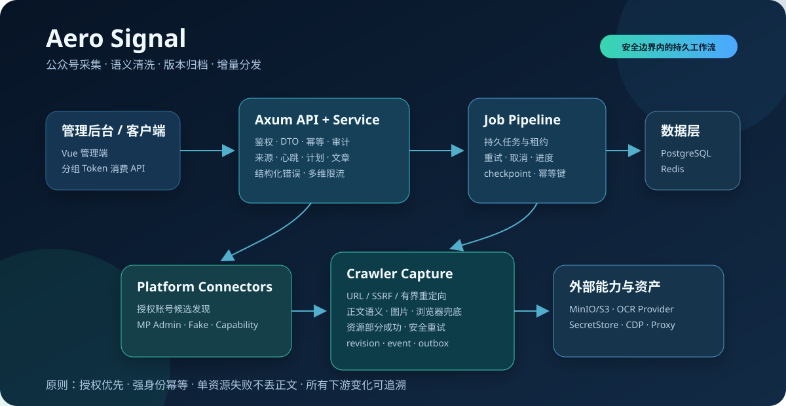

# Aero Signal

[English](README.md) | **简体中文**

<p align="center">
  
</p>

一个面向单服务器部署的微信公众号采集、正文清洗、版本归档和增量分发系统。Signal 将公众号监测、采集账号、异步任务、文章资产、OCR、健康快照和下游 API 统一到可审计、可恢复的工作流中。

> 本项目以开源方式发布，仅用于采集使用者**有权访问和处理**的内容。平台连接器必须遵守授权边界：不实现验证码/WAF 绕过、设备伪装、任意第三方公众号枚举或未授权登录。

## 核心能力

- 微信文章 URL 规范化、敏感参数清理、强身份去重和安全短链解析。
- 采集账号二维码授权、SecretStore 引用和固定出口绑定。
- MP Admin 受限分页发现、最多三篇初始验证及可恢复历史回填。
- HTTP 优先的正文采集，必要时使用受限浏览器渲染懒加载内容。
- 语义化 HTML 清洗和 Markdown 转换，保留标题、列表、引用、代码、表格、链接、图片和媒体占位。
- 正文图片筛选、对象存储、OCR 锚点回填；单资源失败不丢整篇正文。
- 持久 Job、幂等键、租约、重试、取消和进度查询。
- 文章 revision、change event 与 delivery outbox 原子提交。
- 每日健康预检、不可变快照、非等间隔计划和心跳升降级。
- 管理后台以及按分组 Token 授权的增量消费 API。

## 技术栈

| 层级 | 技术 |
| --- | --- |
| 后端 | Rust 1.96、Axum、Tokio、SQLx |
| 数据 | PostgreSQL、Redis、MinIO/S3 |
| 采集 | Reqwest、Chromium CDP、可替换 Connector |
| 前端 | Vue 3、TypeScript、Vite、Pinia |
| 测试 | 内存 Repository、Fake Connector、Fixture/Fake Adapter |

## 项目结构

```text
Signal/
├─ service/                    # HTTP 服务、业务编排、Worker 和仓储实现
├─ crates/
│  ├─ server-core/            # 配置、时钟、错误、鉴权和通用 HTTP 能力
│  ├─ job-pipeline/           # 持久任务、租约、重试、取消和处理器注册
│  ├─ platform-connectors/    # mp_admin / fake / weread 能力适配
│  ├─ crawler-capture/        # URL、正文、图片、SSRF、浏览器和对象存储
│  └─ provider-hub/           # OCR Provider 抽象与 Fake Provider
├─ web/                        # Vue 管理后台
├─ migrations/                 # 只追加的 SQLx 迁移
├─ scripts/                    # 本地资源初始化和冒烟脚本
├─ docs/                       # PRD、技术方案、数据库、API 和部署说明
├─ AGENTS.md                   # Agent/开发者接手入口
└─ SIGNAL_REPAIR_LOOP_PLAN.md  # 已执行的采集链路修复记录
```

## 快速开始

### 1. 环境要求

- Rust 1.96（仓库包含 `rust-toolchain.toml`）
- Node.js 22+、pnpm 11
- PostgreSQL、Redis、MinIO/S3
- 可选：兼容 Chrome DevTools Protocol 的浏览器运行时

### 2. 配置

```powershell
Copy-Item .env.example .env
```

`.env.example` 中只有本地开发默认值。部署前必须更换数据库、对象存储和管理员 bootstrap 凭据，真实密码、Cookie、Token 与代理认证信息不得提交到 Git。

#### 配置项

全部通过环境变量配置（启动时会自动加载工作目录下的 `.env`）。以 `crates/server-core/src/config.rs`、`service/src/adapters/factory.rs` 和 [`docs/部署说明.md`](docs/部署说明.md) 为准。

| 变量 | 默认值 | 说明 |
| --- | --- | --- |
| `SIGNAL_ENV` | `development` | `test` \| `development` \| `production`；production 在连接前检查全部硬依赖并禁止 Fake 回退 |
| `SIGNAL_STORE` | 自动 | `memory` \| `postgres`；未设置时有 `DATABASE_URL` 则 `postgres`，否则 `memory` |
| `DATABASE_URL` | – | PostgreSQL 连接串；`postgres` 模式必填 |
| `SIGNAL_LISTEN_ADDR` | `127.0.0.1:8080` | HTTP 监听地址（也接受 `LISTEN_ADDR`） |
| `SIGNAL_EMBED_WORKER` | `0` | 仅 memory：在 HTTP 进程内嵌 Worker |
| `SIGNAL_SCHEDULER` | `1` | Worker 日调度（07:30 preflight / 08:00 plan）；`0` 关闭 |
| `SIGNAL_WORKER_ID` | `signal-worker-<pid>` | 可选 Worker 标识 |
| `SIGNAL_SECRET_STORE_PATH` | – | 文件 SecretStore 目录；postgres 与 production 模式必填（无默认值） |
| `REDIS_URL` | – | 二维码 ticket 存储；postgres 与 production 模式必填 |
| `REDIS_KEY_PREFIX` | `signal:` | 全部 Redis 键前缀 |
| `S3_ENDPOINT` | – | S3/MinIO（path-style）；postgres 与 production 模式必填，memory 模式缺省时使用 Fake 对象存储 |
| `S3_ACCESS_KEY` / `S3_SECRET_KEY` | – | 对象存储凭据；设置 `S3_ENDPOINT` 时必填 |
| `S3_BUCKET` | `aero-signal-dev` | 资产 bucket |
| `BROWSER_CDP_URL` | – | Chromium 兼容浏览器的 CDP 地址（懒加载渲染），如 `http://127.0.0.1:9222`；开发可选，生产必填 |
| `SIGNAL_MP_ADMIN_PROTOCOL` | 关闭 | `1` / `true` / `yes` 表示 mp_admin 真实扫码登录与已发列表协议就绪；否则 mp_admin 显式 unsupported。非 production 环境始终注册 `fake` connector |
| `SIGNAL_MP_ADMIN_USER_AGENT` | 内置桌面 Chrome 123 UA | mp_admin 协议请求的 `User-Agent`；留空或非法时回退到默认值 |
| `SIGNAL_OCR_PROVIDER` | – | 目前只有 `fake`（非 production 可用）；production 在接入真实 provider 前拒绝启动 |
| `SIGNAL_PRODUCT` | `signal` | `/healthz` 返回的产品名 |
| `SIGNAL_BOOTSTRAP_USERNAME` / `SIGNAL_BOOTSTRAP_PASSWORD` | – | 两者均非空时，`signal-service` 启动时若尚无管理员则自动创建；勿提交真实值 |
| `SIGNAL_BOOTSTRAP_TOKEN` | – | `POST /api/admin/auth/bootstrap` 所需初始化口令（请求体 `bootstrap_token`）；留空则禁用 HTTP bootstrap |
| `RUST_LOG` | – | 日志过滤，如 `info,signal=debug` |

### 3. 初始化并运行

```powershell
# 可选：初始化本地数据库和 MinIO bucket
./scripts/init-dev-resources.ps1

# HTTP API
cargo run -p signal-service --bin signal-service

# 独立 Worker
cargo run -p signal-service --bin signal-worker
```

默认 API 地址：`http://127.0.0.1:8080`。

**初始化管理员**（只需一次；密码 10–128 位，须同时包含字母和数字），二选一：

- 自动（推荐）：启动 `signal-service` 前设置 `SIGNAL_BOOTSTRAP_USERNAME` 与 `SIGNAL_BOOTSTRAP_PASSWORD`。启动时若尚无管理员则自动创建，已有管理员则跳过。Worker 不执行 bootstrap。
- HTTP：设置足够长的随机值 `SIGNAL_BOOTSTRAP_TOKEN` 并重启 `signal-service`，然后调用 `POST /api/admin/auth/bootstrap`，请求体为 `{"username":"admin","password":"<强密码>","bootstrap_token":"<SIGNAL_BOOTSTRAP_TOKEN>"}`。口令以常量时间比较：未配置口令返回 `403 admin.bootstrap_disabled`，口令错误返回 `403 admin.bootstrap_token_invalid`，已有管理员时一律返回 `409 admin.already_bootstrapped`。

首次登录强制改密；初始化完成后请移除上述 bootstrap 变量。

```powershell
cd web
pnpm install
pnpm dev
```

### 4. 轻量本地验收

```powershell
cargo test -p platform-connectors protocol
cargo test -p crawler-capture
cargo test -p signal-service --test source
cargo test -p signal-service --test article_capture
cargo test -p signal-service --lib
cargo fmt --all -- --check
```

不要默认运行真实微信、代理、对象存储或 OCR 端到端测试；新增外部能力应通过 trait 和 fake/fixture 验证。

## 关键业务流程

```text
管理员添加公众号 URL
  → URL/短链安全解析
  → 最多三篇候选验证
  → 确认监测规则
  → 每日预检和计划
  → 候选发现与强身份去重
  → 详情/正文/图片采集
  → 正文与资产原子提交
  → revision + change event + outbox
  → 分组 Token 增量消费
```

## 文档入口

- [Agent 接手与开发指南](AGENTS.md)：模块、流程、约束、测试和继续开发方式。
- [产品需求](docs/PRD.md)
- [技术方案](docs/TECHNICAL_SOLUTION.md)
- [后端模块设计](docs/BACKEND_MODULES.md)
- [数据库设计](docs/DATABASE_DESIGN.md)
- [API 契约](docs/api/OpenAPI与契约冻结.md)
- [错误码表](docs/api/错误码表.md)
- [部署说明](docs/部署说明.md)

## 当前状态

采集修复计划已完成本地验收，包括候选元数据、旧文章判断、短链安全、增量分页、历史回填、语义正文、资源部分成功、结构化错误和多维限流。详细记录见 [Signal 循环修复计划](SIGNAL_REPAIR_LOOP_PLAN.md#14-执行结果2026-07-17)。

## 架构图

- [架构总览](docs/assets/architecture-overview.svg)
- [采集流水线与任务流转](docs/assets/collection-pipeline.svg)
- [数据模型与分发流程](docs/assets/data-model-delivery.svg)

管理后台（全新本地实例的「今日概览」页，尚无数据）：

<p align="center">
  
</p>

## 参与贡献

欢迎提交 Issue 和 Pull Request，提交前请阅读 [CONTRIBUTING.md](CONTRIBUTING.md)。所有贡献必须遵守上文的授权边界。

## 许可证

本项目以 [MIT License](LICENSE) 发布。注意：`Cargo.toml` 的 `workspace.package.license` 目前仍声明为 `MIT OR Apache-2.0`，如需双许可证请补充 Apache-2.0 全文并统一元数据。对外分发前请再次审查第三方依赖许可。
